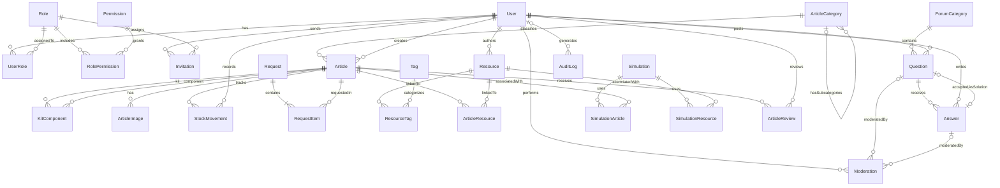

# Second Life Energy

## Introduction

This is an educational web platform that gives electronic materials and components a second life through reuse in kits, activities and learning resources.

This is a school project developed by 2nd-year DAW-T students at IES El Rincón (modules DOR and DSW), based on the specifications of the "Second Life Energy" project coordinated at IES La Guancha. Approved by the Directorate-General for Vocational Training and Special Regime Education — Resolution No. 292/2026 (Volume 1, Book 570, 30/06/2026).

| Layer | Technology |
| --- | --- |
| Backend | Express 5 (Node.js) + TypeScript |
| ORM | Sequelize 6 + sequelize-cli (migrations and seeders) |
| Database | PostgreSQL |
| API documentation and tests | Bruno (`backend/bruno`) |
| Frontend (next sprints) | React + TypeScript + Vite |

## Repository and branches

- `main`: production.
- `staging`: pre-production.
- `develop`: integration branch. Every task is developed in its own branch (`E<team>-HU-<id>-T<task>`) and merged into `develop` through a Pull Request.

## Backend structure

```text
backend/
├── bruno/                      # Bruno collection: documentation + automated API tests
├── database/
│   ├── config.js               # sequelize-cli configuration (reads .env.<environment>)
│   ├── migrations/             # one migration per table, in dependency order
│   ├── seeders/                # demo data, in the same order as the migrations
│   └── utils/reset-sequence.js # moves PostgreSQL sequences after seeding fixed ids
└── src/
    ├── app.ts                  # Express app: JSON body, /api router, 404 and error middlewares
    ├── server.ts               # database connection + HTTP server
    ├── config/                 # environment variables and Sequelize instance
    ├── middlewares/            # error handling, 404, id validation
    ├── models/associations.ts  # every relationship of the ERD
    ├── routes/index.ts         # mounts every module under /api
    ├── utils/                  # HttpError and custom validators
    └── modules/<module>/       # <name>.model.ts, .service.ts, .controller.ts, .routes.ts
```

Every module follows the same convention:

- **Model**: Sequelize class with `declare` fields, validations and `underscored` columns (`createdAt` → `created_at`).
- **Service**: static methods with the Sequelize queries (`findAll` with filters and `include`, `findById`, `create`, `update`, `delete`).
- **Controller**: static methods that validate the request, call the service and answer with the right status code. Errors are forwarded with `next(error)`.
- **Routes**: `GET /`, `GET /:id`, `POST /`, `PUT /:id`, `DELETE /:id`. Join tables use their composite key (`/:userId/:roleId`).

## Setup and development

### 1. Prerequisites

- Git
- Node.js 22.12 or later (with npm)
- PostgreSQL 16 or later, running on `localhost:5432`

### 2. Clone the repository

```bash
git clone --branch develop https://github.com/albertomerino3/second-life-energy.git
cd second-life-energy/backend
```

### 3. Environment variables

The backend loads `backend/.env.<NODE_ENV>`:

- `.env.development` and `.env.test` contain **only local development values** (database on `localhost`, user `postgres`, password `1234`). Change them if your local PostgreSQL uses other credentials.
- Production never reads a file from the repository: the variables come from the environment (Docker / IsardVDI). `.env.production.example` lists them and `.env.production` is ignored by Git.

```dotenv
NODE_ENV=development
PORT=3000
DB_DIALECT=postgres
DB_HOST=localhost
DB_PORT=5432
DB_NAME=db_second_life_energy_dev
DB_USER=postgres
DB_PASSWORD=1234
```

### 4. Install, create the database, migrate and seed

```bash
npm ci
npm run db:create
npm run db:migrate
npm run db:seed
```

### 5. Start the API

```bash
npm run dev
```

The API runs at <http://localhost:3000/api> (for example <http://localhost:3000/api/articles>).

> The schema is managed **only with migrations**. The server never calls `sequelize.sync()`.

### npm scripts

| Script | Description |
| --- | --- |
| `npm run dev` | Starts the API with hot reload (`NODE_ENV=development`) |
| `npm run dev:test` | Starts the API with the test database (`NODE_ENV=test`) |
| `npm run typecheck` / `npm run build` | Type-checks / compiles TypeScript |
| `npm run db:create` / `npm run db:drop` | Creates / drops the database of the current environment |
| `npm run db:migrate` | Runs the pending migrations |
| `npm run db:migrate:undo` / `db:migrate:undo:all` | Reverts the last / every migration (`down()`) |
| `npm run db:migrate:status` | Shows which migrations have been run |
| `npm run db:seed` / `npm run db:seed:undo` | Inserts / removes the demo data |
| `npm run db:reset` | Undoes seeders and migrations and runs everything again |
| `npm run test:api` | Runs the Bruno collection against the running API (writes `bruno-report.html`) |

## Database

### Migrations

There is one migration per table of the ERD, numbered so that every table is created after the tables it references. Every migration has a `down()` that reverts it, so `npm run db:migrate:undo:all` leaves the database empty.

| # | Migration | Table | Depends on |
| --- | --- | --- | --- |
| 01 | create-users | `users` | — |
| 02 | create-roles | `roles` | — |
| 03 | create-permissions | `permissions` | — |
| 04 | create-user-roles | `user_roles` (PK userId + roleId) | users, roles |
| 05 | create-role-permissions | `role_permissions` (PK roleId + permissionId) | roles, permissions |
| 06 | create-invitations | `invitations` | users, roles |
| 07 | create-article-categories | `article_categories` (self reference) | — |
| 08 | create-articles | `articles` | article_categories, users |
| 09 | create-kit-components | `kit_components` (PK kitId + componentId) | articles |
| 10 | create-article-images | `article_images` | articles |
| 11 | create-stock-movements | `stock_movements` | articles, users |
| 12 | create-requests | `requests` | — |
| 13 | create-request-items | `request_items` | requests, articles |
| 14 | create-resources | `resources` | users |
| 15 | create-tags | `tags` | — |
| 16 | create-resource-tags | `resource_tags` (PK resourceId + tagId) | resources, tags |
| 17 | create-article-resources | `article_resources` (PK articleId + resourceId) | articles, resources |
| 18 | create-forum-categories | `forum_categories` | — |
| 19 | create-questions | `questions` | forum_categories, users |
| 20 | create-answers | `answers` | questions, users |
| 21 | add-accepted-answer-fk-to-questions | FK `questions.accepted_answer_id` | answers (circular relationship) |
| 22 | create-moderations | `moderations` | users, questions, answers |
| 23 | create-simulations | `simulations` | — |
| 24 | create-simulation-articles | `simulation_articles` (PK simulationId + articleId) | simulations, articles |
| 25 | create-simulation-resources | `simulation_resources` (PK simulationId + resourceId) | simulations, resources |
| 26 | create-article-reviews | `article_reviews` | articles, users |
| 27 | create-audit-logs | `audit_logs` | users |

ON DELETE rules: join tables and details of a record (images, request items, answers…) use `CASCADE`; authorship (articles, resources, questions… created by a user) uses `RESTRICT`, so authorship is never lost; `audit_logs.user_id` and `questions.accepted_answer_id` use `SET NULL`.

### Seeders

The seeders insert a coherent data set with fixed ids, so the relationships are predictable, and cover the main scenarios of the user stories:

| Seeder | Data | Scenarios |
| --- | --- | --- |
| users, roles, user-roles | 5 users: admin, 2 teachers, 2 students | inactive user |
| permissions, role-permissions | 11 permissions | admin has all; teachers can review and moderate; students create drafts and write in the forum |
| invitations | 4 invitations | used, pending, expired (HU-06) |
| article-categories | 2 root categories + 5 subcategories | self relationship |
| articles, kit-components, article-images | 3 kits and 7 components with images | out of stock articles (HU-03), draft, kit returned by a reviewer (HU-11) |
| stock-movements | 5 movements | in, out, adjustment |
| requests, request-items | 2 demo requests | `DEMO-` references, max. 1 unit per kit / 10 per component (HU-04, HU-05) |
| resources, tags, resource-tags, article-resources | 6 resources, 8 tags | PDF, video, exercise, quiz, link; published and draft (HU-07, HU-08) |
| forum-categories, questions, answers, moderations | 4 categories, 4 questions, 4 answers, 4 moderations | accepted answer, hidden and restored messages (HU-09) |
| simulations, simulation-articles, simulation-resources | 3 simulations | Falstad and Wokwi related to kits and resources (HU-10) |
| article-reviews, audit-logs | 3 reviews, 4 logs | approved / returned with comments, permission change and publication audit (HU-11) |

Demo accounts (local development only, password `Demo1234!`, stored as a bcrypt hash):

| Email | Role |
| --- | --- |
| `admin@second-life-energy.test` | admin |
| `laura.perez@second-life-energy.test` | teacher |
| `marcos.diaz@second-life-energy.test` | teacher |
| `ana.rodriguez@second-life-energy.test` | student |
| `pablo.hernandez@second-life-energy.test` | student (inactive) |

### Relationships (ERD)

The models follow the project ERD. All the relationships are defined in [`backend/src/models/associations.ts`](backend/src/models/associations.ts) and are used by the services with `include`.



## API

Base URL: `http://localhost:3000/api`. Every module has the basic CRUD and returns its related data with `include`.

| Module | Endpoints | Filters (query string) and related data |
| --- | --- | --- |
| Users | `/users`, `/users/:id` | `isActive`; includes roles. `passwordHash` is never returned |
| Roles | `/roles`, `/roles/:id` | includes permissions (and users in the detail) |
| Permissions | `/permissions`, `/permissions/:id` | detail includes the roles that grant it |
| User roles | `/user-roles`, `/user-roles/:userId/:roleId` | `userId`, `roleId` |
| Role permissions | `/role-permissions`, `/role-permissions/role/:roleId`, `/role-permissions/:roleId/:permissionId` | `roleId`, `permissionId` (no PUT) |
| Invitations | `/invitations`, `/invitations/:id` | `state` = pending / used / expired; includes who invited and the role |
| Article categories | `/article-categories`, `/article-categories/:id` | `rootOnly`; includes parent category and subcategories |
| Articles | `/articles`, `/articles/:id` | HU-03: `search`, `categoryId`, `type`, `status`, `available`, `sort` (id/name/stock/createdAt), `order` (asc/desc). Detail with category, author, images, components, kits, resources and simulations |
| Kit components | `/kit-components`, `/kit-components/:kitId/:componentId` | `kitId`; only links a kit with a component; PUT changes `quantity` |
| Article images | `/article-images`, `/article-images/:id` | `articleId` |
| Stock movements | `/stock-movements`, `/stock-movements/:id` | `articleId` |
| Requests | `/requests`, `/requests/:id` | `status`; includes items and articles. The server generates a `DEMO-` reference |
| Request items | `/request-items`, `/request-items/:id` | `requestId`; rejects out of stock articles and more than 1 kit / 10 components (HU-04) |
| Resources | `/resources`, `/resources/:id` | HU-07: `search`, `type`, `topic`, `difficulty`, `status`, `authorId`, `tag`; HTTPS URLs only |
| Tags | `/tags`, `/tags/:id` | detail includes the resources |
| Resource tags | `/resource-tags`, `/resource-tags/:resourceId/:tagId` | `resourceId`, `tagId` (no PUT) |
| Article resources | `/article-resources`, `/article-resources/:articleId/:resourceId` | `articleId`, `resourceId` (no PUT) |
| Forum categories | `/forum-categories`, `/forum-categories/:id` | detail includes the visible questions |
| Questions | `/questions`, `/questions/:id`, `/questions/category/:categoryId` | `search`, `categoryId`, `status`; detail with answers and accepted answer |
| Answers | `/answers`, `/answers/:id`, `/answers/question/:questionId` | `questionId` |
| Moderations | `/moderations`, `/moderations/:id` | `questionId`, `answerId`; POST hides/restores the message in a transaction (HU-09) |
| Simulations | `/simulations`, `/simulations/:id` | `platform` (falstad / wokwi); includes articles and resources |
| Simulation articles | `/simulation-articles`, `/simulation-articles/:simulationId/:articleId` | `simulationId`, `articleId` (no PUT) |
| Simulation resources | `/simulation-resources`, `/simulation-resources/:simulationId/:resourceId` | `simulationId`, `resourceId` (no PUT) |
| Article reviews | `/article-reviews`, `/article-reviews/:id` | `articleId`, `decision`; returning a kit requires comments (HU-11) |
| Audit logs | `/audit-logs`, `/audit-logs/:id` | `entity`, `entityId`, `userId` |

Pure join tables (only a composite key) have no PUT: a relationship is changed by deleting it and creating it again.

Examples:

```text
GET /api/articles?type=component&available=true&sort=stock&order=desc
GET /api/articles?search=solar
GET /api/resources?type=pdf&difficulty=beginner&tag=seguridad
GET /api/questions?categoryId=2&status=solved
GET /api/invitations?state=pending
```

Status codes:

| Code | When |
| --- | --- |
| 200 / 201 / 204 | OK / created / deleted |
| 400 | Missing required fields, failed validation, invalid id (`/users/abc`) or malformed JSON |
| 404 | Record or route not found |
| 409 | Duplicated unique value, reference to a record that does not exist, record still in use (`RESTRICT`) or business rule (e.g. out of stock article) |

## API documentation and tests with Bruno

The [`backend/bruno`](backend/bruno) folder is a [Bruno](https://www.usebruno.com/) collection with one folder per module. Every request is documented (`docs` tab) and has automated tests: status codes, related data, filters and business rules. Each folder creates, updates and deletes its own records, so the collection can be run many times.

1. Open Bruno → *Open Collection* → select `backend/bruno` and choose the `local` environment.
2. Or run every test from the terminal, with the API running:

```bash
npm run db:reset
npm run dev
npm run test:api
```

## Recommended links

- [Express documentation](https://expressjs.com/) — routing, middleware, and backend APIs.
- [Sequelize v6 documentation](https://sequelize.org/docs/v6/) — models, associations and queries.
- [Sequelize migrations](https://sequelize.org/docs/v6/other-topics/migrations/) — sequelize-cli migrations and seeders.
- [PostgreSQL documentation](https://www.postgresql.org/docs/) — database server.
- [Bruno documentation](https://docs.usebruno.com/) — API client and CLI.
- [npm ci documentation](https://docs.npmjs.com/cli/v11/commands/npm-ci/) — installing dependencies from a lockfile.
