# Second Life Energy

## Introduction

This is an educational web platform that gives electronic materials and components a second life through reuse in kits, activities and learning resources.

This is a school project developed by 2nd-year DAW-T students at IES El Rincón (modules DOR and DSW), based on the specifications of the "Second Life Energy" project coordinated at IES La Guancha. Approved by the Directorate-General for Vocational Training and Special Regime Education — Resolution No. 292/2026 (Volume 1, Book 570, 30/06/2026).

The backend uses TypeScript, Express, Sequelize and PostgreSQL. The frontend will use TypeScript, React and Vite.

## Setup and development

### 1. Prerequisites

Install Git, Node.js 22.12+ with npm, and PostgreSQL. Make sure the PostgreSQL server is running before starting the backend.

### 2. Clone the repository

```bash
git clone --branch develop https://github.com/albertomerino3/second-life-energy.git
cd second-life-energy/backend
```

### 3. Environment variables

The backend reads `backend/.env.development` (local values: `localhost:5432`, user `postgres`, password `1234`). Change them if your PostgreSQL uses other credentials. In production the variables come from the environment (see `.env.production.example`).

### 4. Install dependencies and create the database

```bash
npm ci
npm run db:create
npm run db:migrate
npm run db:seed
```

### 5. Start the backend

```bash
npm run dev
```

The API runs at [http://localhost:3000/api](http://localhost:3000/api), for example [http://localhost:3000/api/articles](http://localhost:3000/api/articles).

## Database

- **Migrations** (`backend/database/migrations`): one migration per table of the ERD, ordered so that each table is created after the tables it references. Revert them with `npm run db:migrate:undo:all`.
- **Seeders** (`backend/database/seeders`): demo data for every table (users and roles, kits and components, requests, resources, forum, simulations...). Demo users use the password `Demo1234!`.
- `npm run db:reset` reverts and runs again all the migrations and seeders.

## API

Each module in `backend/src/modules` has its model, service, controller and routes, with the basic CRUD:

```text
GET    /api/<module>        GET    /api/<module>/:id
POST   /api/<module>        PUT    /api/<module>/:id        DELETE /api/<module>/:id
```

Modules: users, roles, permissions, user-roles, role-permissions, invitations, article-categories, articles, kit-components, article-images, stock-movements, requests, request-items, resources, tags, resource-tags, article-resources, forum-categories, questions, answers, moderations, simulations, simulation-articles, simulation-resources, article-reviews and audit-logs.

The relationships between entities are defined in `backend/src/models/associations.ts` and the services use them in their queries (`include`). Some lists accept filters, for example `/api/articles?type=component&available=true` or `/api/resources?type=pdf`.

## ER Diagram

```mermaid
erDiagram
    User ||--o{ UserRole : has
    Role ||--o{ UserRole : assignedTo

    Role ||--o{ RolePermission : includes
    Permission ||--o{ RolePermission : grants

    User ||--o{ Invitation : sends
    Role ||--o{ Invitation : assigns

    ArticleCategory |o--o{ ArticleCategory : hasSubcategories
    ArticleCategory ||--o{ Article : classifies
    User ||--o{ Article : creates

    Article ||--o{ KitComponent : kit
    Article ||--o{ KitComponent : component
    Article ||--o{ ArticleImage : has

    Article ||--o{ StockMovement : tracks
    User ||--o{ StockMovement : records

    Request ||--|{ RequestItem : contains
    Article ||--o{ RequestItem : requestedIn

    User ||--o{ Resource : authors
    Resource ||--o{ ResourceTag : has
    Tag ||--o{ ResourceTag : categorizes

    Article ||--o{ ArticleResource : linkedTo
    Resource ||--o{ ArticleResource : linkedTo

    ForumCategory ||--o{ Question : contains
    User ||--o{ Question : posts
    Question ||--o{ Answer : receives
    User ||--o{ Answer : writes
    Answer |o--o| Question : acceptedAsSolution

    User ||--o{ Moderation : performs
    Question |o--o{ Moderation : moderatedBy
    Answer |o--o{ Moderation : moderatedBy

    Simulation ||--o{ SimulationArticle : uses
    Article ||--o{ SimulationArticle : associatedWith
    Simulation ||--o{ SimulationResource : uses
    Resource ||--o{ SimulationResource : associatedWith

    Article ||--o{ ArticleReview : receives
    User ||--o{ ArticleReview : reviews

    User |o--o{ AuditLog : generates

    User {
        int id PK
        string name
        string email UK
        string passwordHash
        boolean isActive
        datetime createdAt
        datetime updatedAt
    }

    Role {
        int id PK
        string name UK
        string description
    }

    Permission {
        int id PK
        string code UK
        string description
    }

    UserRole {
        int userId PK,FK
        int roleId PK,FK
        datetime assignedAt
    }

    RolePermission {
        int roleId PK,FK
        int permissionId PK,FK
    }

    Invitation {
        int id PK
        int invitedById FK
        int roleId FK
        string email
        string tokenHash UK
        datetime expiresAt
        datetime usedAt
        datetime createdAt
    }

    ArticleCategory {
        int id PK
        string name UK
        string description
        int parentCategoryId FK
    }

    Article {
        int id PK
        int categoryId FK
        int createdById FK
        string name
        string description
        string type
        string specifications
        int stock
        string status
        datetime createdAt
        datetime updatedAt
    }

    KitComponent {
        int kitId PK,FK
        int componentId PK,FK
        int quantity
    }

    ArticleImage {
        int id PK
        int articleId FK
        string url
        string altText
        int sortOrder
    }

    StockMovement {
        int id PK
        int articleId FK
        int userId FK
        string type
        int quantity
        string reason
        datetime createdAt
    }

    Request {
        int id PK
        string reference UK
        string contactName
        string contactEmail
        string notes
        string status
        datetime createdAt
    }

    RequestItem {
        int id PK
        int requestId FK
        int articleId FK
        int quantity
    }

    Resource {
        int id PK
        int authorId FK
        string title
        string description
        string type
        string topic
        string difficulty
        string url
        string status
        datetime publishedAt
        datetime createdAt
    }

    Tag {
        int id PK
        string name UK
        string slug UK
    }

    ResourceTag {
        int resourceId PK,FK
        int tagId PK,FK
    }

    ArticleResource {
        int articleId PK,FK
        int resourceId PK,FK
    }

    ForumCategory {
        int id PK
        string name UK
        string description
    }

    Question {
        int id PK
        int categoryId FK
        int authorId FK
        int acceptedAnswerId FK
        string title
        string content
        string status
        datetime createdAt
    }

    Answer {
        int id PK
        int questionId FK
        int authorId FK
        string content
        string status
        datetime createdAt
    }

    Moderation {
        int id PK
        int moderatorId FK
        int questionId FK
        int answerId FK
        string action
        string reason
        datetime createdAt
    }

    Simulation {
        int id PK
        string title
        string description
        string platform
        string url
        string objectives
        string materials
    }

    SimulationArticle {
        int simulationId PK,FK
        int articleId PK,FK
    }

    SimulationResource {
        int simulationId PK,FK
        int resourceId PK,FK
    }

    ArticleReview {
        int id PK
        int articleId FK
        int reviewerId FK
        string decision
        string comments
        datetime createdAt
    }

    AuditLog {
        int id PK
        int userId FK
        string entity
        int entityId
        string action
        json previousValues
        json newValues
        datetime createdAt
    }
```



## RBAC (Role-Based Access Control)

The application implements Role-Based Access Control (RBAC) to manage user permissions.

Three roles are defined:

- **ADMIN**: Full access to the application.
- **MANAGER**: Can manage bicycles, inventory, and orders.
- **CUSTOMER**: Can browse bicycles and create and view their own orders.

### RBAC Permissions Matrix

| Permission | ADMIN | TEACHER | STUDENT |
|---|:---:|:---:|:---:|
| `forum-categories:read` | ✅ | ✅ | ✅ |
| `forum-categories:create` | ✅ | ✅ | ❌ |
| `forum-categories:update` | ✅ | ✅ | ❌ |
| `forum-categories:delete` | ✅ | ✅ | ❌ |
| `questions:read` | ✅ | ✅ | ✅ |
| `questions:create` | ✅ | ✅ | ✅ |
| `questions:update` | ✅ | ✅ | ❌* |
| `questions:delete` | ✅ | ✅ | ❌* |
| `answers:read` | ✅ | ✅ | ✅ |
| `answers:create` | ✅ | ✅ | ✅ |
| `answers:update` | ✅ | ✅ | ❌* |
| `answers:delete` | ✅ | ❌ | ❌* |
| `moderations:read` | ✅ | ✅ | ❌ |
| `moderations:create` | ✅ | ✅ | ❌ |
| `moderations:update` | ✅ | ✅ | ❌ |
| `moderations:delete` | ✅ | ❌ | ❌ |
| `permissions:read` | ✅ | ❌ | ❌ |
| `permissions:create` | ✅ | ❌ | ❌ |
| `permissions:update` | ✅ | ❌ | ❌ |
| `permissions:delete` | ✅ | ❌ | ❌ |
| `role-permissions:read` | ✅ | ❌ | ❌ |
| `role-permissions:create` | ✅ | ❌ | ❌ |
| `role-permissions:update` | ❌ | ❌ | ❌ |
| `role-permissions:delete` | ✅ | ❌ | ❌ |


**Notes:**

- `ADMIN` has all permissions.
- `TEACHER ` can manage forum categories, questions and answers, and moderate forum content.
- `STUDENT ` can read forum content and create questions and answers.
- (*) Students can only update or delete their own questions and answers.
- Moderation actions are restricted to ADMIN and TEACHER. Only ADMIN can delete moderation records.
- Only ADMIN can manage permissions and role-permission assignments.
- Permissions are assigned to roles through the RolePermission entity, and roles are assigned to users through many-to-many relationships.
- Authentication uses JWT Bearer Tokens, while authorization is enforced through RBAC middleware.
- The backend is responsible for enforcing permissions, regardless of frontend restrictions.

## Bruno

The endpoints are documented and tested in `backend/docs/second-life-energy.json`. Import it in Bruno (*Import Collection → Postman Collection*), start the backend and run the collection.

## Recommended links

- [Express documentation](https://expressjs.com/) — routing, middleware, and backend APIs.
- [Sequelize v6 documentation](https://sequelize.org/docs/v6/) — models and database queries.
- [PostgreSQL documentation](https://www.postgresql.org/docs/) — database server.
- [Bruno documentation](https://docs.usebruno.com/) — API client.
- [npm ci documentation](https://docs.npmjs.com/cli/v11/commands/npm-ci/) — installing dependencies from a lockfile.
