# Second Life Energy

Educational web platform that gives electronic materials and components a second life through reuse in kits, activities and learning resources.

This is a school project developed by 2nd-year DAW-T students at IES El Rincón (modules DOR and DSW), based on the specifications of the "Second Life Energy" project coordinated at IES La Guancha. Approved by the Directorate-General for Vocational Training and Special Regime Education — Resolution No. 292/2026 (Volume 1, Book 570, 30/06/2026).

It contains:
* Frontend:
    - Built with React + TypeScript + Vite + Tailwind CSS v4 + Headless UI.
    - Connects to the backend via REST API, using JWT Bearer authentication.
    - Public area: catalog of recovered kits and components, simulated request (no payments), educational resources, Q&A forum (public reading) and electronics simulators.
    - Restricted management area for invited users: articles, resources, invitations, users, simulations and audit logs.
* Backend:
    - Built with Node.js + Express + TypeScript + Sequelize + PostgreSQL.
    - It provides REST API endpoints for the frontend, one module per entity (model, service, controller and routes).
    - JWT authentication, with permissions checked on the server.
    - Middleware for Role-Based Access Control (RBAC) to manage user permissions.
    - End-points documented and tested with BRUNO (`backend/docs/bruno/second-life-energy/`, OpenCollection YAML format). Run `Auth > login` first: it saves the token used by the other requests.
    - 26 tables.
    - Sequelize migrations and seeders for database initialization. Demo users use the password `Demo1234!`.
    - Sequelize models for each table with relationships.
    - Sequelize queries for CRUD operations, and eager loading for related data.

## Getting Started

These instructions will get you a copy of the project up and running on your local machine for development and testing purposes.

### Prerequisites

You need a working environment with:
* [Git](https://git-scm.com) - You can install it from https://git-scm.com/downloads.
* [Node](https://nodejs.org) - Node.js 22.12+ with npm, from https://nodejs.org/es/download/.
* [PostgreSQL](https://www.postgresql.org/download/) - Make sure the PostgreSQL server is running before starting the backend.
* [BRUNO](https://www.usebruno.com/download) - To test the API endpoints.

### Installing

Clone this project:

```
git clone --branch develop https://github.com/albertomerino3/second-life-energy.git
```

Now install all dependencies.

```
cd second-life-energy/frontend
npm ci
cd ../backend
npm ci
```

Edit backend/.env.development to set the database connection parameters (local values: `localhost:5432`, user `postgres`, password `1234`). In production the variables come from the environment (see `.env.production.example`).

Copy the frontend/.env.example file to frontend/.env and edit it to set the backend url. (the default is http://localhost:3000/api)

```
cd ../frontend
cp .env.example .env
```

Create the database in PostgreSQL and run the migrations and seeders to initialize it.

```
cd ../backend
npm run db:create
npm run db:migrate
npm run db:seed
```

Run the project to see the resulting page:

```
cd backend
npm run dev
cd ../frontend
npm run dev
```

You can now access the frontend at http://localhost:5173 and the backend at http://localhost:3000/api, for example http://localhost:3000/api/articles.

Enjoy!

## ER Diagram

The database has 26 tables. Many-to-many relationships (users and roles, roles and permissions, kits and components...) use their own join tables.

```mermaid
erDiagram
    User ||--o{ UserRole : has
    Role ||--o{ UserRole : assignedTo
    Role ||--o{ RolePermission : includes
    Permission ||--o{ RolePermission : grants
    User ||--o{ Invitation : sends
    Role ||--o{ Invitation : assigns
    ArticleCategory ||--o{ Article : classifies
    User ||--o{ Article : creates
    Article ||--o{ KitComponent : kit
    Article ||--o{ KitComponent : component
    Article ||--o{ ArticleImage : has
    Article ||--o{ StockMovement : tracks
    User ||--o{ StockMovement : records
    Request ||--|{ RequestItem : contains
    Article ||--o{ RequestItem : requestedIn
    User ||--o{ Resource : authors
    Resource ||--o{ ResourceTag : has
    Tag ||--o{ ResourceTag : categorizes
    Article ||--o{ ArticleResource : linkedTo
    Resource ||--o{ ArticleResource : linkedTo
    ForumCategory ||--o{ Question : contains
    User ||--o{ Question : posts
    Question ||--o{ Answer : receives
    User ||--o{ Answer : writes
    Answer |o--o| Question : acceptedAsSolution
    User ||--o{ Moderation : performs
    Question |o--o{ Moderation : moderatedBy
    Answer |o--o{ Moderation : moderatedBy
    Simulation ||--o{ SimulationArticle : uses
    Article ||--o{ SimulationArticle : associatedWith
    Simulation ||--o{ SimulationResource : uses
    Resource ||--o{ SimulationResource : associatedWith
    Article ||--o{ ArticleReview : receives
    User ||--o{ ArticleReview : reviews
    User |o--o{ AuditLog : generates

    User {
        int id PK
        string name
        string email UK
        string passwordHash
        boolean isActive
        datetime createdAt
        datetime updatedAt
    }

    Role {
        int id PK
        string name UK
        string description
    }

    Permission {
        int id PK
        string code UK
        string description
    }

    UserRole {
        int userId PK, FK
        int roleId PK, FK
        datetime assignedAt
    }

    RolePermission {
        int roleId PK, FK
        int permissionId PK, FK
    }

    Invitation {
        int id PK
        int invitedById FK
        int roleId FK
        string email
        string tokenHash UK
        datetime expiresAt
        datetime usedAt
        datetime createdAt
    }

    ArticleCategory {
        int id PK
        string name UK
        string description
        int parentCategoryId FK
    }

    Article {
        int id PK
        int categoryId FK
        int createdById FK
        string name
        string description
        string type
        string specifications
        int stock
        string status
        datetime createdAt
        datetime updatedAt
    }

    KitComponent {
        int kitId PK, FK
        int componentId PK, FK
        int quantity
    }

    ArticleImage {
        int id PK
        int articleId FK
        string url
        string altText
        int sortOrder
    }

    StockMovement {
        int id PK
        int articleId FK
        int userId FK
        string type
        int quantity
        string reason
        datetime createdAt
    }

    Request {
        int id PK
        string reference UK
        string contactName
        string contactEmail
        string notes
        string status
        datetime createdAt
    }

    RequestItem {
        int id PK
        int requestId FK
        int articleId FK
        int quantity
    }

    Resource {
        int id PK
        int authorId FK
        string title
        string description
        string type
        string topic
        string difficulty
        string url
        string status
        datetime publishedAt
        datetime createdAt
    }

    Tag {
        int id PK
        string name UK
        string slug UK
    }

    ResourceTag {
        int resourceId PK, FK
        int tagId PK, FK
    }

    ArticleResource {
        int articleId PK, FK
        int resourceId PK, FK
    }

    ForumCategory {
        int id PK
        string name UK
        string description
    }

    Question {
        int id PK
        int categoryId FK
        int authorId FK
        int acceptedAnswerId FK
        string title
        string content
        string status
        datetime createdAt
    }

    Answer {
        int id PK
        int questionId FK
        int authorId FK
        string content
        string status
        datetime createdAt
    }

    Moderation {
        int id PK
        int moderatorId FK
        int questionId FK
        int answerId FK
        string action
        string reason
        datetime createdAt
    }

    Simulation {
        int id PK
        string title
        string description
        string platform
        string url
        string objectives
        string materials
    }

    SimulationArticle {
        int simulationId PK, FK
        int articleId PK, FK
    }

    SimulationResource {
        int simulationId PK, FK
        int resourceId PK, FK
    }

    ArticleReview {
        int id PK
        int articleId FK
        int reviewerId FK
        string decision
        string comments
        datetime createdAt
    }

    AuditLog {
        int id PK
        int userId FK
        string entity
        int entityId
        string action
        json previousValues
        json newValues
        datetime createdAt
    }
```



## RBAC (Role-Based Access Control)

The application implements Role-Based Access Control (RBAC) to manage user permissions.

There is no public registration of internal profiles: accounts are created through invitations, and the invited person does not choose their own role. Invitations expire and can only be used once.

Three roles are defined:

- **ADMIN**: Full access to the application.
- **TEACHER**: Invited by an administrator. Manages their own resources, takes part in the forum and reviews the articles sent by students.
- **STUDENT**: Invited by a teacher with delegated permission. Takes part in the forum and, if authorized, creates article drafts and sends them to review.

Visitors do not have an account or a role. They can browse the catalog, the resources, the forum (read only) and the simulations, and they can prepare and confirm a simulated request.

### RBAC Permissions Matrix

| Permission | ADMIN | TEACHER | STUDENT |
|---|:---:|:---:|:---:|
| `articles:read` | ✅ | ✅ | ✅ |
| `articles:create` | ✅ | ✅ | ✅** |
| `articles:update` | ✅ | ✅* | ✅*,** |
| `articles:review` | ✅ | ✅ | ❌ |
| `articles:delete` | ✅ | ❌ | ❌ |
| `requests:read` | ✅ | ❌ | ❌ |
| `requests:update` | ✅ | ❌ | ❌ |
| `resources:read` | ✅ | ✅ | ✅ |
| `resources:create` | ✅ | ✅ | ❌ |
| `resources:update` | ✅ | ✅* | ❌ |
| `resources:delete` | ✅ | ✅* | ❌ |
| `forum:read` | ✅ | ✅ | ✅ |
| `forum:create` | ✅ | ✅ | ✅ |
| `forum:update` | ✅* | ✅* | ✅* |
| `forum:moderate` | ✅ | ✅** | ❌ |
| `simulations:read` | ✅ | ✅ | ✅ |
| `simulations:manage` | ✅ | ❌ | ❌ |
| `invitations:create_teacher` | ✅ | ❌ | ❌ |
| `invitations:create_student` | ✅ | ✅** | ❌ |
| `users:manage` | ✅ | ❌ | ❌ |
| `roles:manage` | ✅ | ❌ | ❌ |
| `audit:read` | ✅ | ❌ | ❌ |

**Notes:**

- `ADMIN` has all permissions.
- `TEACHER` can manage their own resources and review articles, but cannot delete articles or manage users, roles and requests.
- `STUDENT` has limited permissions.
- (*) Users only act on their own records (own resources, own drafts, own forum posts). This restriction is an ownership check on top of the permission. `ADMIN` can manage resources of any author without altering their authorship, but nobody edits another person's forum post: moderators hide or restore it with a reason.
- (**) Delegated permission: it is not part of the role by default, an administrator grants it to a specific account by assigning an additional role that carries only that permission.
- Articles follow the flow `draft` → `in_review` → `published`, or `returned` with comments.
- Permissions are assigned to roles through `RolePermission`, and roles are assigned to users through `UserRole`, so a user can hold more than one role.
- An `Invitation` stores the role (`roleId`) that the invited person will receive, who sent it (`invitedById`), a hashed token, an expiry date and the date it was used.
- Authentication uses JWT Bearer Tokens, while authorization is enforced through RBAC middleware.
- The backend is responsible for enforcing permissions, regardless of frontend restrictions.

## Built With

* [Git](https://git-scm.com) - Version control, with GitHub for pull requests and GitHub Actions.
* [Node](https://nodejs.org) - JavaScript runtime. It's advisable to install the LTS version.
* [PostgreSQL](https://www.postgresql.org/docs/) - Database server.
* [Bruno](https://docs.usebruno.com/) - API client used to document and test the endpoints.
* [Vite](https://vite.dev/) - The Build Tool for the Web.
* [React](https://react.dev/) - A JavaScript library for building user interfaces.
* [Tailwind CSS](https://tailwindcss.com/) - A utility-first CSS framework for rapid UI development.
* [Headless UI](https://headlessui.com/) - Unstyled, fully accessible UI components, designed to integrate with Tailwind CSS.
* [Express](https://expressjs.com/) - Routing, middleware and backend APIs.
* [Sequelize v6](https://sequelize.org/docs/v6/) - Promise-based Node.js ORM for models and database queries.
* [npm ci](https://docs.npmjs.com/cli/v11/commands/npm-ci/) - Installing dependencies from a lockfile.
* [Docker](https://docs.docker.com/compose/) and [Caddy](https://caddyserver.com/) - Production deployment on IsardVDI with automatic HTTPS.

## Acknowledgments

* The "Second Life Energy" project coordinator at IES La Guancha, whose specifications this project is based on.
* The [Bicycle Shop](https://github.com/tcrurav/TypeScript-Express-Sequelize-Associations_and_Queries-Example) example, used as the reference for the project structure and for this README.